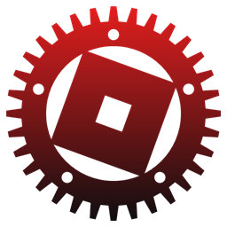

<div align="center">
  
  <h1>RustBlox</h1>
  <p><strong>A fast, lightweight, open-source Windows launcher for Roblox written in Rust.</strong></p>

  <p>
    <a href="https://github.com/gothssmy-design/rustblox/releases/latest">
      
    </a>
    <a href="https://github.com/gothssmy-design/rustblox/releases">
      
    </a>
    <a href="https://github.com/gothssmy-design/rustblox/blob/main/LICENSE">
      
    </a>
    
    
  </p>

  <p>
    <a href="https://github.com/gothssmy-design/rustblox/releases/latest"><strong>Download Latest Release (<code>rustblox.exe</code>)</strong></a>
    ·
    <a href="https://github.com/gothssmy-design/rustblox/issues">Report a Bug</a>
  </p>
</div>

---

## Why RustBlox?

The official Roblox Desktop app boots the full 3D game-engine UI and crash handler just to browse games or check your friends list. **RustBlox** gives you a native `egui` launcher in a single portable **27.4 MB** executable and only starts `RobloxPlayerBeta.exe` when you click **Play**.

Measured side-by-side on Windows (`RustBlox v0.2.0` vs official `RobloxPlayerBeta.exe --app`):

| Metric | RustBlox | Official Roblox App (`--app`) |
| --- | --- | --- |
| **Disk Footprint** | **27.4 MB** (single `.exe`) | **358.8 MB** (install folder) |
| **Startup Time (warm)** | **~0.2 s** (`194–238 ms`) | **~2.6 s** (`2,625 ms`) |
| **Idle Working Set RAM** | **318 – 324 MB** | **1,076.8 MB** (`RobloxPlayerBeta` + `RobloxCrashHandler`) |
| **Idle Private RAM** | **343 – 348 MB** | **1,278.3 MB** |

*(When you click **Play**, Roblox still runs `RobloxPlayerBeta.exe` for the 3D game itself. Once you exit, RustBlox can automatically close lingering background Roblox processes so they don't sit idle in memory.)*

---

## Features

- **Quick Login & Encrypted Sessions:** Never asks for or stores your password. Sign in with Roblox's official Quick Login code or QR approved on `roblox.com`. Active sessions (`session.dat`) and saved multi-account profiles (`accounts.dat`) are encrypted locally with **Windows DPAPI** and tied to your Windows user account.
- **Native Hardware-Accelerated UI:** Rendered directly in Rust via `eframe` + `egui` (`0.37`) — no WebView, Chromium, or Electron overhead — with smooth animations, hover WebM/VP8 game video previews, and a 3D avatar preview.
- **Game Discovery & Server Browser:** Browse Home, Charts, Search, Recent games, Favorites, Game Passes, and live public servers.
- **Friends & Social:** Manage friends, incoming friend requests, followers, following, and user profiles.
- **FastFlags & Target FPS:** Set FPS caps (`60`, `120`, `144`, `240`, `999`), choose renderers (`Auto`, `Direct3D 11`, `Vulkan`, `OpenGL`), lighting & texture presets, or import/export custom FastFlags JSON (`ClientAppSettings.json`).
- **Auto-Close Background Roblox:** Automatically closes lingering background/tray Roblox processes after leaving a game.
- **Smart Notifications:** Minimalist top-center popups, Silent mode toggle, and persistent show-once deduplication covering updates, background auto-kill alerts, and incoming friend requests.
- **Themes & Live Showcase:** Light/Dark modes, custom solid/wallpaper backgrounds, text contrast controls, and a live preview showcase for Home, Profile, and Login screens in Settings.
- **Built-In Self-Updater:** Check and install updates right inside Settings without uninstalling or reinstalling:
  - **Major/UI Updates:** Closes cleanly into an **Updating RustBlox** window with progress bar, swaps the `.exe`, and relaunches automatically.
  - **Small Bugfix Patches:** Applies in the background with no restart required.
  - Never installs automatically unless you click Update.

---

## Getting Started

1. Make sure the official **Roblox Player** is installed once from [roblox.com](https://www.roblox.com).
2. Download the single `rustblox.exe` from [**Releases**](https://github.com/gothssmy-design/rustblox/releases/latest) (no installer or extra folders needed — put it on your Desktop or anywhere writable).
3. Run `rustblox.exe` and sign in using **Roblox Quick Login**.

> All settings, themes, FastFlags, and encrypted sessions are stored in `%LOCALAPPDATA%\rustblox`, so replacing or updating `rustblox.exe` keeps your data intact.

---

## FAQ

**Is RustBlox free?**
Yes, RustBlox is 100% free and open source under GPL-3.0.

**Does it need anything installed?**
Windows 10 or Windows 11, plus the official Roblox Player installed once from `roblox.com`. RustBlox itself is a standalone `rustblox.exe` with no extra runtime or installer folders.

**Does it store my password or login anywhere?**
No. RustBlox never asks for or stores your password. Login uses Roblox Quick Login on `roblox.com`, and your local session cookie is encrypted on your PC with Windows DPAPI (and zero-wiped when you sign out).

**Is there a ban risk?**
RustBlox is a launcher, not an exploit, script executor, or memory injector — it launches the official `RobloxPlayerBeta.exe` client and configures `ClientAppSettings.json` FastFlags (similar to Bloxstrap). That said, because it is an unofficial third-party tool, zero risk can never be guaranteed if Roblox changes its policies or if you import risky custom FastFlags yourself.

---

## Building from Source

Requires [Rust](https://rustup.rs/) (`edition = "2024"`) on Windows:

```powershell
git clone https://github.com/gothssmy-design/rustblox.git
cd rustblox
cargo build --release
```

The standalone executable will be generated at `target\release\rustblox.exe`.

---

## License

Licensed under the [**GNU General Public License v3.0 (GPL-3.0)**](LICENSE).
